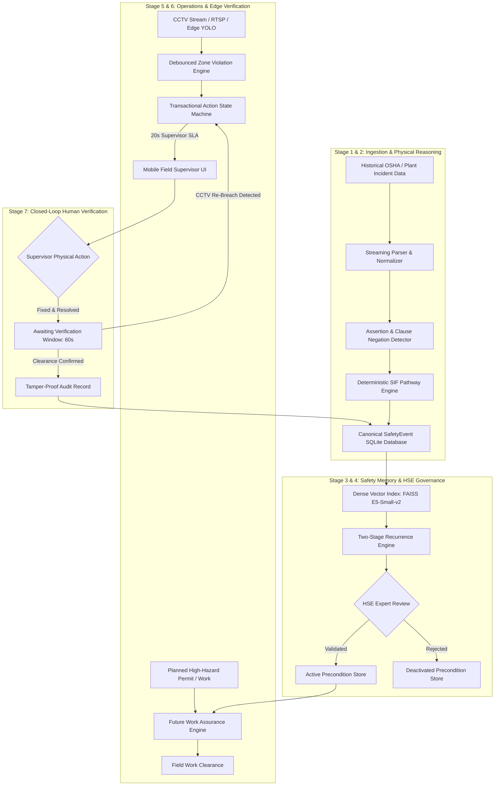
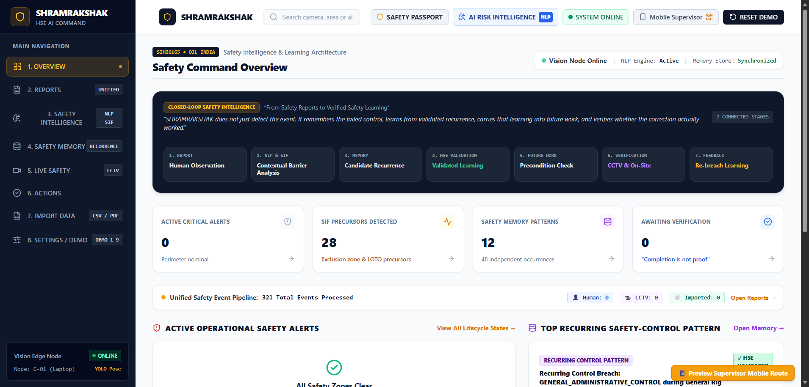
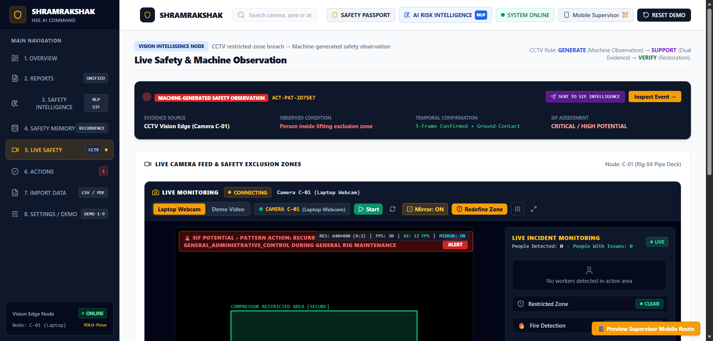
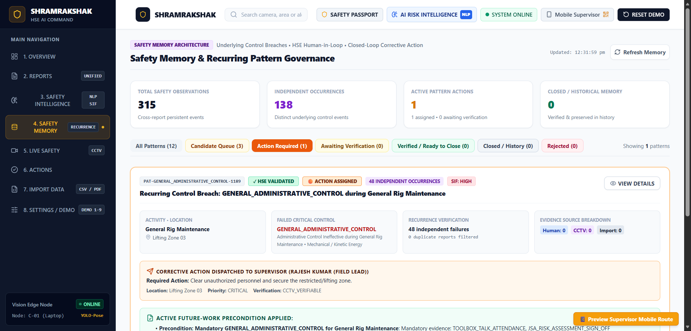
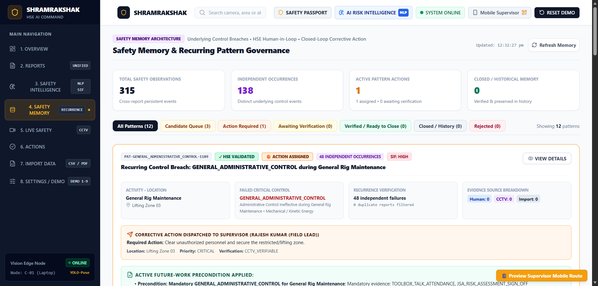
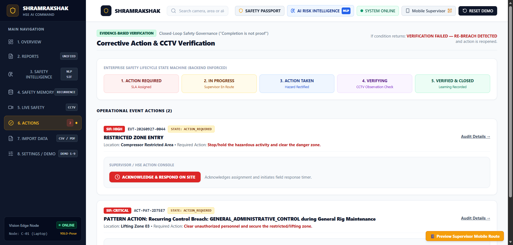

# 🛡️ SHRAMRAKSHAK: Industrial AI Safety Intelligence & Closed-Loop SIF Prevention

> **Smart India Hackathon (SIH 2024 / 2026 Finalist Platform — Problem Statement SIH26165)**  
> *AI/NLP Engine to Detect Serious Injury & Fatality (SIF) Precursors in Unsafe-Act / Unsafe-Condition & Near-Miss Reports with Closed-Loop CCTV Verification*

[](LICENSE)
[](https://www.python.org/)
[](https://fastapi.tiangolo.com/)
[](https://react.dev/)
[](https://github.com/facebookresearch/faiss)
[](tests/)

---

## 📌 One-Line Description
SHRAMRAKSHAK is an enterprise safety intelligence platform that autonomously extracts high-energy SIF precursors from industrial incident logs, detects recurring control breaches via dense semantic memory, and enforces closed-loop resolution with real-time edge CCTV verification.

---

## 🚨 The Problem

High-hazard industrial sectors (oil & gas, petrochemicals, heavy manufacturing, construction) process thousands of safety observation reports annually. Despite extensive logging, organizations face critical systemic vulnerabilities:

1. **Passive "Lagging" Dashboards**: Incident forms simply record past injuries without extracting actionable precursor patterns that precede catastrophic events.
2. **"Pencil-Whipping" Resolutions**: Supervisors frequently sign off on corrective actions without physical on-site verification, allowing identical control failures to recur days later.
3. **Information Silos**: Recurrent breaches across different plant units or contractor crews remain undetected because narrative descriptions vary in terminology.
4. **Disconnected Systems**: Plant CCTV feeds, manual inspection forms, and permit-to-work systems operate in isolation, lacking unified real-time risk intelligence.

---

## 💡 The Solution

SHRAMRAKSHAK transforms safety management from **"reports that describe the past"** into **"evidence that protects the future"** through a continuous **7-Stage Closed-Loop Safety Ecosystem**:



---

## ✨ Key Features

- **Dual-Layer Deterministic SIF Engine**: Evaluates high-energy hazards, affirmed human exposures, and compromised barriers against standardized IOGP Life-Saving Rules. Safely abstains to `REVIEW_REQUIRED` under uncertainty.
- **Linguistic Assertion & Negation Detection**: Filters medical negations, historical anecdotes, and hypothetical phrasing to eliminate false-positive hazard triggers.
- **E5 + FAISS Dense Semantic Safety Memory**: Bijective vector index powered by `intfloat/e5-small-v2` and `faiss.IndexFlatIP` discovering cross-facility recurring breaches.
- **HSE Human Expert Governance**: Strict workflow where AI only proposes `CANDIDATE` patterns, requiring human HSE specialist validation before preconditions are enforced.
- **Pre-Task Future Work Assurance**: Matches upcoming work permits against active validated preconditions to stop recurring accidents before work begins.
- **Edge CCTV Multi-Hazard Inference**: Real-time ONNX inference detecting PPE non-compliance (hard hats, safety vests, gloves), exclusion zone intrusions with 3D ground polygon projection, and hazardous flame/fire.
- **Closed-Loop Resolution & Re-Breach Detection**: Action state machine with 60-second observation windows; any re-violation immediately reopens the alert and flags the supervisor.

---

## 🖼️ System Screenshots

| Executive HSE Dashboard | Real-Time Edge CCTV Safety |
|:---:|:---:|
|  |  |
| **Semantic Safety Memory** | **HSE Expert Pattern Validation** |
|  |  |
| **Transactional Action Management** | **Mobile Field Supervisor View** |
|  |  |

---

## 🧰 Technology Stack

| Layer | Technologies Used |
| :--- | :--- |
| **Frontend** | React 18, Vite, Tailwind CSS, Lucide Icons, Canvas-Confetti |
| **Backend** | Python 3.10+, FastAPI, Uvicorn (ASGI), WebSockets |
| **Storage & Database** | SQLite (WAL journal mode with foreign keys), Bijective Vector Mapping |
| **AI / NLP** | Hugging Face Transformers (`intfloat/e5-small-v2`), PyTorch, Clause Preprocessor |
| **Vector Engine** | FAISS CPU (`IndexFlatIP(384)`) with cosine similarity normalization |
| **Computer Vision** | OpenCV, ONNX Runtime (`ppe_safety.onnx`, `yolov8n.onnx`, `fire_detection.onnx`) |
| **Ontology & Rules** | Modular YAML Schemas (Activities, Energies, Barriers, Consequences, LSR) |
| **Audit & Reports** | ReportLab, PyPDF (Automated executive compliance PDF generation) |

---

## 📁 Project Structure

```text
SHRAMRAKSHAK/
│
├── backend/
│   ├── data/                     # Canonical SQLite database, FAISS index, datasets
│   │   ├── shramrakshak.db       # Pre-populated SQLite database (334 events, 11 tables)
│   │   ├── e5_faiss.index        # Normalized 384-d FAISS vector index
│   │   ├── e5_faiss_mapping.json # Bijective ID-to-Event mapping table
│   │   └── January2015toNovember2025.csv # External industrial benchmark dataset
│   ├── dataset_pipeline/         # Modular ingestion, normalization & run manifests
│   ├── nlp_engine/               # Preprocessor, assertion detector, SIF engine, semantic memory
│   ├── detection.py              # Real-time ONNX computer vision & zone occupancy
│   ├── database.py               # SQLite DatabaseManager with WAL resilience
│   ├── models_canonical.py       # Canonical Pydantic domain models
│   ├── state.py                  # Transactional alert state machine
│   ├── main.py                   # FastAPI application & WebSocket broadcast
│   ├── ppe_safety.onnx           # 13-class PPE detection ONNX model
│   ├── yolov8n.onnx              # COCO object detection ONNX model
│   └── fire_detection.onnx       # Industrial flame detection ONNX model
│
├── frontend/
│   ├── src/                      # React components, views, services
│   │   ├── components/           # Executive cards, modals, drawers, CCTV viewers
│   │   ├── pages/                # Desktop Dashboard & Mobile Supervisor views
│   │   └── services/             # WebSocket and REST API client
│   ├── package.json              # Frontend dependencies
│   └── vite.config.js            # Vite bundler & reverse proxy configuration
│
├── ontology/                     # Standardized industrial safety schemas (YAML)
│   ├── activities.yaml
│   ├── barriers.yaml
│   ├── barrier_states.yaml
│   ├── consequences.yaml
│   ├── energies.yaml
│   ├── exposures.yaml
│   ├── lsr_rules.yaml
│   └── uncertainty.yaml
│
├── tests/                        # Acceptance, regression & clean-room test harness
│   ├── test_isolation.py         # Hermetic clean-room test storage
│   ├── test_master_closed_loop_acceptance.py  # 15-step master acceptance suite
│   └── test_true_closed_loop_e2e.py           # End-to-end pipeline verification
│
├── tools/
│   └── check_memory_integrity.py # Diagnostic memory and vector alignment auditor
│
├── docs/                         # Technical architecture & guides
│   ├── architecture.md           # System architecture & mathematical foundations
│   ├── setup.md                  # Comprehensive setup & troubleshooting guide
│   ├── api.md                    # REST & WebSocket API reference
│   └── screenshots/              # Polished system screenshots
│
├── .gitignore                    # Clean repository ignore patterns
├── LICENSE                       # MIT License
├── README.md                     # Project submission documentation
└── requirements.txt              # Exact Python dependencies
```

---

## ⚡ Quick Start Guide

### 1. Clone the Repository
```powershell
git clone https://github.com/VishnuMor369/SHRAMRAKSHAK-SIH.git
cd SHRAMRAKSHAK-SIH
```

### 2. Install Dependencies

#### Backend:
```powershell
pip install -r requirements.txt
```

#### Frontend:
```powershell
cd frontend
npm install
cd ..
```

---

## 🚀 Running the Application

### Step 1: Start Backend Server
In the first terminal:
```powershell
cd backend
python -m uvicorn main:app --host 0.0.0.0 --port 8000
```
- **Backend API**: `http://localhost:8000`
- **Interactive OpenAPI Documentation**: `http://localhost:8000/docs`

### Step 2: Start Frontend Application
In a second terminal:
```powershell
cd frontend
npm run dev
```
- **HSE Executive Dashboard**: `http://localhost:5173`
- **Mobile Field Supervisor View**: `http://localhost:5173/supervisor`

---

## 🧪 Automated Testing & Verification

Run the hermetic clean-room 15-step master acceptance suite to verify all 7 stages of the closed loop:

```powershell
python tests/test_master_closed_loop_acceptance.py
```

Audit memory integrity (verifies 100% bijective alignment between SQLite events, embeddings, FAISS vectors, and mappings):

```powershell
python tools/check_memory_integrity.py
```

---

## 🏆 Smart India Hackathon (SIH) Relevance

- **Problem Statement ID**: SIH26165
- **Problem Statement Title**: AI/NLP Engine to Detect Serious Injury & Fatality (SIF) Precursors in Unsafe-Act / Unsafe-Condition and Near-Miss Reports
- **Organization / Ministry**: Oil India Limited (OIL), Ministry of Petroleum and Natural Gas
- **SIH Alignment**:
  - Implements physics-based SIF potential determination (eliminates black-box probability guesses).
  - Normalizes multi-source incident reports into IOGP Life-Saving Rules.
  - Converts recurrent hazard findings into proactive future-work permits.
  - Couples field computer vision with supervisor accountability to eliminate re-breaches.

---

## 👥 Hackathon Team

- **Team Name**: BRAINSTACK
- **Lead Developer**: Vishnu Mor (`vishnumor369@gmail.com`)
- **Repository**: [https://github.com/VishnuMor369/SHRAMRAKSHAK-SIH](https://github.com/VishnuMor369/SHRAMRAKSHAK-SIH)

---

## 📄 License

This project is licensed under the MIT License. See [LICENSE](LICENSE) for details.
